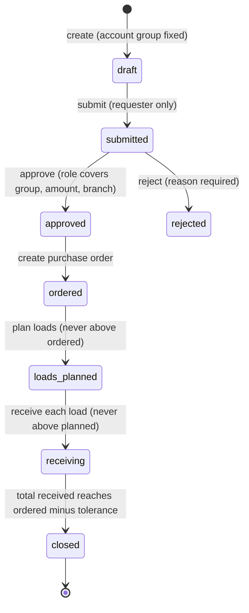

# approval-workflow

**A procure-to-pay workflow where approval authority belongs to the _role_, not the person.**

Most approval systems store "who approves" as a list of people. Then someone is hired, leaves or changes jobs, and the chain breaks silently: requests get stuck with nobody able to approve them, or — worse — a former employee is still in the path.

This library models the organisation the way it actually works and enforces the procurement rules in code:

```
Department → Sector → Role → Employee        (+ a matrix link to one or more branches)
                       └── authority rules: account groups · amount limit · branches · advance payments
```

Requisition → approval → purchase order → loads → receiving, with every gate **blocking** the step instead of warning about it. Zero runtime dependencies, fully typed, 36 tests.

## The flow



## What it looks like

`npm run demo` walks through a real week:

```

▸ Ana (buyer) opens a requisition for 1,000 units of raw material at HQ — 12,000.00 total
  ✘ add a freight line to the same requisition → MIXED_ACCOUNT_GROUP: requisition REQ-42 is "inputs"; a "freight" item needs its own requisition

▸ Who can approve it? (answered by roles, not by a list of names)
   [ 'Davi (director)', 'Rita (manager)' ]
  ✘ Caio (coordinator, limit 10k) approves → NO_AUTHORITY: caio cannot approve REQ-42: role has no authority for this group, amount or branch

▸ Rita, the manager, leaves the company. A new manager is hired into the same role.
  ✘ Rita tries to approve after leaving → NO_AUTHORITY: rita cannot approve REQ-42: employee is no longer active
  ✔ Leo approves on day one, no reconfiguration

▸ Purchase order on advance-payment terms
  can release payment? false
  ✘ Leo (manager) approves the advance → NO_AUTHORITY: advance payments need a role with advance-payment authority
  ✔ Davi (director) approves the advance
  can release payment? true

▸ The supplier ships in two trucks; the warehouse receives against each load
  after truck 1: open { 'RAW-7': 600 }
  after truck 2: closed { 'RAW-7': 995 } (within 2% tolerance)

▸ Audit trail
  #1 ana       requisition.created      REQ-42
  #2 ana       requisition.submitted    REQ-42
  #3 leo       requisition.approved     REQ-42
  #4 ana       order.created            PO-42
  #5 davi      order.advance_approved   PO-42
  #6 ana       load.planned             PO-42/TRUCK-1
  #7 ana       load.planned             PO-42/TRUCK-2
  #8 warehouse load.received            PO-42/TRUCK-1
  #9 warehouse load.received            PO-42/TRUCK-2
  #10 warehouse order.closed             PO-42
```

## Design decisions

**1. Authority lives on the role.** `Org.approversFor(request)` answers *"who can approve this?"* from role rules. Hiring someone into a role gives them its authority on day one; `terminate()` removes every authority at once; `transfer()` moves authority with the job. There is no list of names to keep in sync.

**2. A requisition is born with one account group and never mixes.** Goods, inputs, services and freight go to different budget lines and often to different approvers. Mixing them in one document is how costs end up in the wrong place, so `addItem` refuses it.

**3. Gates block, they don't warn.** Over the limit, wrong branch, wrong account group, self-approval, inactive employee, order from an unapproved requisition, receiving more than planned — each one throws a `WorkflowError` with a stable `code`, so an API or UI can show the exact reason.

**4. Advance payment is its own gated action.** Paying before delivery is a different risk from approving a purchase, so it needs a rule with `canApproveAdvancePayment` (typically board-level). The normal approval path cannot reach it.

**5. Parent / child orders.** One purchase order is often delivered in several trucks. The warehouse receives against each load (child); the order (parent) only closes when the **total** received reaches the ordered quantity within tolerance. A partial delivery can never silently close a purchase — or release its payment.

**6. Everything is audited.** Every transition writes an event with a sequence number, actor, target and details (including which role authorised an approval).

## Usage

```ts
import { Org, Workflow } from "approval-workflow";

const org = new Org()
  .addBranch({ id: "HQ", name: "Headquarters", kind: "headquarters" })
  .addDepartment({ id: "PROC", name: "Procurement" })
  .addSector({ id: "PURCH", departmentId: "PROC", name: "Purchasing" })
  .addRole({
    id: "manager", sectorId: "PURCH", name: "Procurement Manager",
    authority: [{ accountGroups: ["goods", "inputs"], maxAmount: 100_000 }],
  })
  .addRole({ id: "buyer", sectorId: "PURCH", name: "Buyer", authority: [] });

org.hire({ id: "rita", name: "Rita", roleId: "manager", branchIds: ["HQ"] });
org.hire({ id: "ana",  name: "Ana",  roleId: "buyer",   branchIds: ["HQ"] });

const wf = new Workflow(org, { tolerance: 0.02 });
wf.createRequisition({ id: "REQ-1", requesterId: "ana", branchId: "HQ", accountGroup: "inputs" });
wf.addItem("REQ-1", { sku: "RAW-7", qty: 1000, unitPrice: 12, accountGroup: "inputs" });
wf.submit("REQ-1", "ana");
wf.approve("REQ-1", "rita");
```

## Run it

```bash
npm install
npm test          # 36 tests (vitest)
npm run typecheck
npm run demo
```

## Project layout

```
src/org.ts         organisation model, authority rules, hire / terminate / transfer
src/workflow.ts    requisitions, approval gate, purchase orders, loads, receiving, audit
test/              36 tests covering every gate and transition
examples/demo.ts   the scenario shown above
```

## Context

A generic, clean-room implementation of a role-based approval model for multi-branch companies. Tying authority to roles instead of people removes a whole class of "stuck" and "wrong approver" problems when people join, leave or move. All names and data here are synthetic.

MIT licensed.
